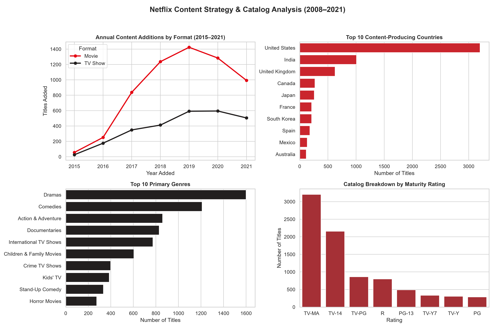

# Netflix Content Strategy & Catalog Exploratory Data Analysis (Python)

End-to-end exploratory data analysis of **8,807 Netflix titles** using **Python (`Pandas`, `Matplotlib`, `Seaborn`)** to uncover catalog format shifts, international production growth, genre dominance, and runtime patterns.

## Project Workflow
* **Data Cleaning (`netflix_analysis.py`):** Audited missing values across 12 columns, imputed null metadata (`director`, `cast`, `country`, `rating`), removed 13 incomplete records (`date_added`, `duration`), parsed datetime fields, and engineered `year_added`, `month_added`, `primary_country`, `primary_genre`, and numeric `duration_num` across **8,794 clean titles**.
* **Exploratory Analysis & Visualization (`netflix_eda.py`):** Aggregated multi-dimensional trends and built a 4-panel executive summary (`netflix_eda_summary.png`).

## Visual Summary

## Key Analytical Findings
1. **Movie-Heavy Catalog with Rapid Expansion Peak:** Movies make up **69.7%** (`6,128` titles) vs. **30.3%** TV Shows (`2,666` titles). Catalog additions peaked in **2019 (`2,016` titles)** before tapering slightly in 2020 (`1,879` titles).
2. **Global Production Concentration:** The **United States (`3,202` titles)** leads catalog volume, followed by **India (`1,008`)**, the **United Kingdom (`627`)**, **Canada (`271`)**, and **Japan (`258`)**.
3. **Core Genres & Mature Audience Focus:** **Dramas (`1,600`)**, **Comedies (`1,210`)**, and **Action & Adventure (`859`)** lead primary genres, while **TV-MA** and **TV-14** dominate maturity ratings.
4. **Format Runtime Benchmarks:** Movies have a **median runtime of 98 minutes** (mean `99.6` mins), whereas **67.3%** of TV Shows run for a single season, reflecting a focus on limited series and high-turnover releases.

## Business Recommendations
* **Invest in Regional Originals in High-Growth Markets:** India (`1,008` titles) and Japan (`258` titles) represent strong international anchors where localized dramas and comedies drive global catalog differentiation.
* **Balance Limited-Series Volume with Multi-Season Franchises:** With over two-thirds (`67.3%`) of TV Shows ending after Season 1, selectively renewing top-performing `TV-MA` and `TV-14` dramas can improve long-term subscriber retention.
